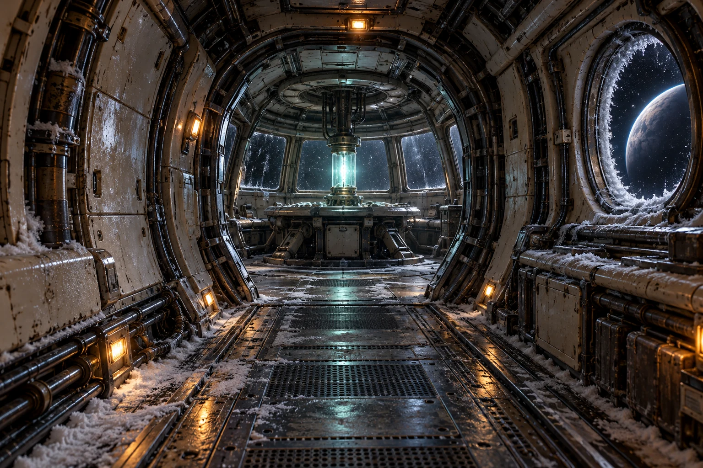

# Starship Explorer

**Explore strange worlds. Bring your people back. Build a way home.**

A single-player space expedition for laptop and desktop browsers. Captain the ISS Lodestar in a
seeded galaxy, recover scientific discoveries, lead boarding teams and defend
survey ships. Research the Return Drive while the voyage continues, then decide
when you are ready to leave.



## Play the current game

Choose **Begin expedition** to see a three-part crew briefing, then take command. **Resume expedition**
continues its browser autosave. Enter a galaxy seed to revisit the same
generated world.

Every expedition screen has clear navigation: **Current system**, **On board**, **Galaxy chart**,
**Research lab** and **Discoveries**. **On board** contains the bridge, science deck,
engineering and shuttle bay. Choose a portrait to speak to a crew member in their
room. The main screen presents one immediate priority, and relevant actions stay
visible without burying them behind portraits.

1. Open the **Research lab** and start **Drive Diagnostics** so research advances
   while you explore. The lab's tab is flagged **idle** whenever nothing is
   being researched. Tick **Continue the route home automatically** in the lab if
   you want each later drive project to start by itself once its requirements
   are met.
2. Survey the arrival system and open **The Silent Courier** from the places
   along the bottom of the screen.
3. Choose a story response, with advice from named officers. The **Review
   expedition options** or **Open station services** button exposes the location
   controls. Helen Morozova's portrait still opens and closes the briefing.
4. Follow research leads (shown in a project's details, nearest first), visit
   stations and collect independent spatial or propulsion discoveries. On the
   **Galaxy chart**, hover a star for a second or select it for its card, or use
   **Find system**; choose **Travel the route** to fly every jump in one order.
   The course pauses if research completes on the way.
5. Research, construct and field-test the prototype. Finish Drive Stabilisation,
   construct the Return Drive and choose **Return home** when ready.

**Discoveries** keeps the voyage record: side voyages in progress, the
captain's decisions, recovered sources and the full captain's log.

**Classic Voyage has been retired from the application.** Visiting `/?classic`
also opens Open Expedition. The older engine code and legacy test fixtures remain
in the repository for historical reference and save verification; Classic is no
longer a player-selectable game. Its separate browser save is not erased.

## What is playable

| System | Current implementation |
| --- | --- |
| Expedition | Seeded galaxy, persistent sites, passive/survey/deep scans, travel, stations and discovery archive |
| Research | All 29 projects across six branches; one active project, three queue slots, construction and fitting |
| Encounters | Ten authored templates, Courier letters, The Long Relay and Someone left behind (a rescued survivor’s follow-up) |
| Boarding | Four-person squads; core recovery, rescue, sabotage, salvage and fragile-recorder extraction; nine standard operation configurations plus the recorder vault |
| Tactical decisions | Cover, line of sight, fog, AP, aim, overwatch, equipment, extraction and persistent injuries/casualties |
| Tactical feedback | Route/AP/exposure/heat previews, targeting lines, hit/miss and damage summaries, depth-sorted figures; ordered enemy turns with speed and skip controls |
| Ship encounters | FTL-style real-time combat with pause: projectiles in flight, telegraphed enemy targeting, crew at battle stations, fires, reactor power, compartment targeting, volleys and synthesised battle sound. Station escorts, and hostile interceptions on jumps into hostile space, with negotiation, evasion, salvage and tow-home failure |
| Presentation | Interactive galaxy atlas; four illustrated ship rooms with original crew portraits and contextual dialogue; cinematic site art; directional boarding animation; laptop controls |
| Persistence | Version-11 expedition journals; versions 1–10 supported (their battles and jumps replay under the rules they were played with); explicit survivor identity tracking on new deployments; Classic Voyage kept separate |
| Finish | Research, prototype test, Return Drive construction, voluntary return and voyage summary |

This is a playable game under active development. Long faction arcs, a developed
crew relationship system, rank abilities, photorealistic character fidelity and
full-run human balance validation remain ahead. Character frames come from consistent
articulated rigs; they are still stylised. Layout variations include reflected plans.
No runtime AI API or 3D renderer is required by the game.

## Ship combat

Jumps into hostile space (red on the Galaxy chart; each system's card gives the
interception risk) can end in a weapons lock. Stations also offer optional survey
escorts. On contact, hail, pay, try to break the lock, or engage. Battles start
paused.

- **Space** pauses and resumes; everything in flight freezes mid-air.
- **Choose a target:** select a weapon (**1–4**), then click an enemy compartment.
  Weapons open aimed at the enemy's shields. **Auto** fires when charged and
  **hold** keeps a full charge. **F** fires the selected weapon; **V** fires every
  charged weapon together, for example a held laser and missile to break a shield.
- **Read their guns:** a hostile gun locks one of our compartments at 60% charge.
  The room shows a red reticle and a countdown.
- **Command the crew:** Mori, Cross, Morozova and Kerr man the helm, weapons,
  shields and engines. Choose an officer, then a compartment. Officers repair and
  fight fires where they stand. The helm needs one for evasion. Hits and fires
  wound them; a downed officer returns from the medical bay after 20 seconds.
- **Reactor:** power shields (two per layer), engines (evasion and retreat) and
  weapons. Charge a retreat with working engines to jump away.

First arrivals in a new system often pick up a **signal**: a distress call that
may be bait, a hulk to strip, a trader, refugees short of fuel, a trapped weapons
cache and more. Each offers choices with their costs and risks shown, and always a
way to walk away.

Victory over an interceptor salvages materials, credits and fuel. A disabled ship
is towed home at a cost. See [docs/FTL-COMBAT.md](docs/FTL-COMBAT.md).

## Laptop controls

Boarding gives the deck the screen. The squad runs down the left: select an
operative's bar for their portrait, weapon and segmented stat bars, and the
mission tag beside the turn counter for the objective. Hover a lit tile to
preview the move (AP, exposure, heat; sprints are chosen by distance) and click
to move. Hover a visible hostile to preview the shot and click to fire. On a
touch screen, the first tap previews and a second tap orders. The quick bar
under the deck holds **Action** (reload, objective, recorder, medkits), **Aim**,
**Overwatch**, **Heal self** and **End turn**. **Enlarge map** hides the squad to
give the deck more width; **Fit map** restores it.

- **1–4**: select operative; **N**: next operative with AP.
- **F**: fire at the selected target; **R**: reload; **O**: overwatch.
- **Shift+Enter**: end turn. Hostile actions play in sequence at **1× or 2×**.
- **Esc** or **Skip playback**: return directly to the resolved turn.

The turn is saved immediately; animation never rerolls a shot. Reduced motion
skips the sequence and retains the written combat summary. These controls do
not activate while typing or while the extraction confirmation is open.

[Latest laptop milestone and actual screenshots](docs/LAPTOP-BOARDING.md).

## Play the survivor follow-up

Rescue at least one surveyor through a new **Rescue** deployment and acknowledge
the debrief. At a contacted station, accept **Someone left behind** from that
actual survivor. Follow the marked destination, investigate it, then choose
**Prepare recorder recovery**. The carrier moves two tiles per AP and cannot
sprint. Lifting the recorder wakes two reserve custodians; hand it to another
operative by setting it down and lifting it again. Bring it to the shuttle or
withdraw without it, then return to the original station for the survivor’s reply.
Evidence pays 24 credits once. This return visit awards no normal site cargo.

Old rescue logs recorded counts only; they are not assigned invented identities.
Your next rescue enables the new request. The Return Drive remains available
regardless of optional mission progress.

## Run locally

Use Node.js 22.12+ on the Node 22 line (CI uses Node 22) and npm.

```bash
npm ci
npm run dev
```

Open the local URL printed by Vite. Saves live in that browser and origin;
there is no account or cloud-save service. Clearing browser storage removes
local progress. Replacing an expedition prompts first.

```bash
npm run build       # TypeScript check + production build into dist/
npm run preview     # serve the production build locally
```

## Validate changes

```bash
npm test
npm run typecheck
npx playwright install chromium
npm run test:e2e
npm run exploration:simulate -- 20
npm run tactical:simulate -- 12
npm run ship:simulate -- 20
node --import tsx tools/operation-walkthrough.ts 12
```

For constrained environments use `npm test -- --maxWorkers=2` and
`npm run test:e2e -- --workers=2`. `PLAYWRIGHT_CHROMIUM_EXECUTABLE_PATH` can point
to an existing compatible Chromium executable. Playwright starts Vite on port 4173.

Latest implementation: **19 October 2026**. See
[the animation and survivor milestone](docs/ANIMATED-BOARDING-AND-SURVIVORS.md)
for exact scope, validation, reproduction and real game captures. Vite still reports
a JavaScript chunk-size advisory. Human balance and visual-quality playtesting remain open.

## Design and development

| Document | Purpose |
| --- | --- |
| [Game design](docs/DESIGN.md) | Player experience, systems, narrative, art, pacing and quality bar |
| [Implementation specification](docs/SPECIFICATION.md) | Current contracts, architecture, compatibility and acceptance criteria |
| [Roadmap](docs/ROADMAP.md) | Prioritised milestones and completion gates |
| [Next design milestone](docs/NEXT.md) | A connected-story slice: The Long Relay |
| [Classic design](docs/CLASSIC-DESIGN.md) | The preserved mystery campaign |
| [Redesign history](docs/REDESIGN-V2.md) | Original proposal and dated implementation notes |
| [Latest tactical review](docs/TACTICAL-READABILITY.md) | Movement guidance, damage feedback and depth-order validation |

`DESIGN.md` owns experience and scope; `SPECIFICATION.md` owns implementation
contracts; `ROADMAP.md` owns priority. Historical notes record earlier states.
Features marked **planned** are not implemented by publishing their design.

```text
src/engine/exploration/  Expedition, research, stories and ship battle
src/engine/tactical/     Boarding rules, operations and deck variants
src/engine/state/        Classic Voyage state and reducer
src/engine/mystery/      Classic deduction puzzle
src/ui/                  React views, presentation helpers and persistence
public/assets/           Shipped static assets
tests/                  Rules, replay, compatibility and property tests
e2e/                    Browser scenarios
tools/                  Seeded campaign and combat pilots
docs/                   Design, specification and milestone evidence
```

React 19 · TypeScript · Vite · Tailwind/CSS · Vitest · Playwright. Expedition rules
are pure seeded reducers. The UI requests actions and presents outcomes; it does
not decide combat results. Retired Classic Voyage code is retained only as historical material.

## Contribution and release rules

- Keep mandatory science reachable and optional combat optional.
- Preserve accepted old journals; introduce new mechanics explicitly and version
  saves when required. Never silently reinterpret old actions.
- Test the failure modes a change introduces: invalid orders, repeated rewards,
  hidden-information leaks and reload boundaries.
- Review changed screens at 1366×768, 1440×900 and 1920×1080, with keyboard and reduced motion. Laptop/desktop play is the product target; narrow layouts are a fallback.
- Publish the reviewed, tested tree to `main` and verify deployment status.
- Record generated-art prompts and provenance in milestone notes. Keep text,
  controls and tactical information out of raster artwork.

Repository: [henders23/starship-explorer](https://github.com/henders23/starship-explorer).
The product name is **Starship Explorer**; the ship is the ISS Lodestar.

## Character-led experience (19 October 2026)

This update makes **ISS Lodestar** the ship's visible identity and focuses on people
rather than menus. Captain Alexander Vale, science officer Helen Morozova,
security chief Gabriel Cross, navigator Lena Mori and engineer Jonas Kerr have
consistent portraits and concise dialogue in ship rooms, locations and decisions.
Dialogue does not alter simulation rules; it reflects what the campaign actually
knows. The current-system view keeps a captain's immediate priority visible, and
the mission objective is expanded by default during boarding.

The old start background remains in the repository until the supplied Lodestar
image is available as a transferable asset. It is deliberately not replaced with
an unrelated illustration. See [the character-led UX brief](docs/LODSTAR-EXPERIENCE.md).


## Opening and report illustrations

New expeditions open with a short, skippable briefing from Mori, Kerr and Vale, establishing how the Lodestar became stranded and the first priorities. Event reports have a separate illustration layer keyed to the *event*, not the location or system background; the same image follows each decision into the captain's record. For implementation details see [the experience spec](docs/OPENING-REPORT-UX.md).
