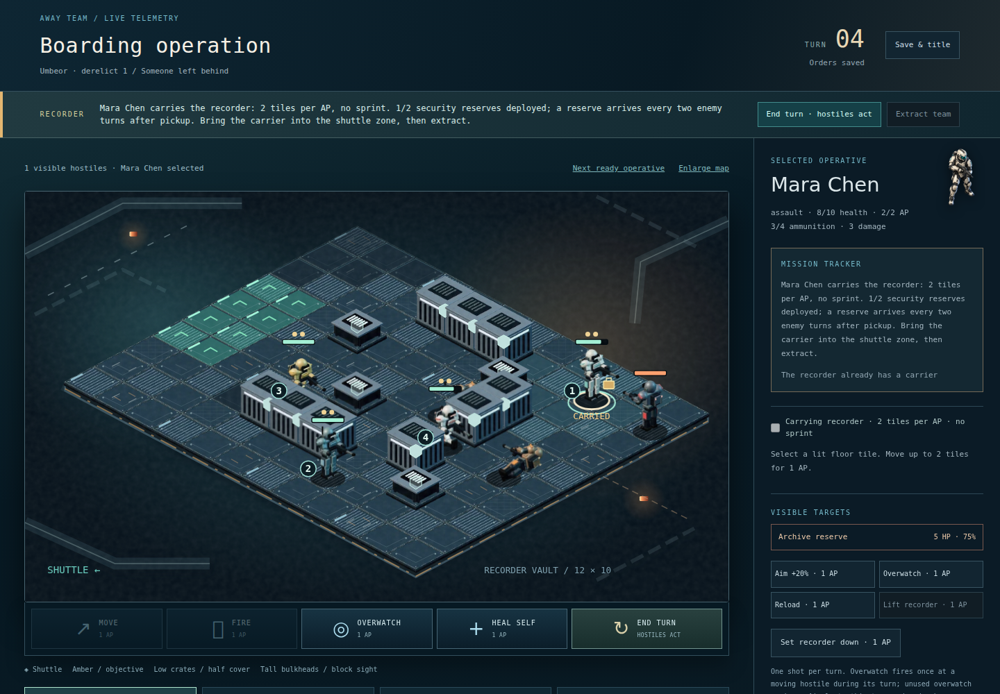

# Animated boarding and Someone left behind

Implemented 12 October 2026. This increment builds on the merged galactic atlas,
six warships, escort artwork and The Long Relay. It does not replace those systems.

## What changed

- **Characters:** five role-specific operative rigs and two custodian appearances.
  Each atlas has eight independently rendered directions and 38 poses: idle,
  eight walk, eight sprint, aim, four fire, three hit, four fall, four interact,
  cover and four reload frames. Weapons are never mirrored. Role colours and
  equipment remain consistent. Renders use authored Three.js geometry, joint
  transforms, metallic materials, rounded armour and deterministic surface wear.
- **Animation:** poses derive from real unit changes. Movement uses the existing
  route finder, turns with each route segment and interpolates at a steady rate.
  Health/AP marks follow the displayed position; depth ordering follows motion.
  Orders and autosaves update immediately. A newer move cancels the previous
  visual interpolation and begins from its authoritative endpoint; there is no
  queued simulation delay. Reduced motion snaps to canonical positions and
  disables pose cycling. Idle rigs do not run continuous animation loops.
- **Interiors:** ten rendered material/module assets for steel, grating, medical
  floors, warning floors, bulkheads, medical cabinets, servers, low cover, cargo
  and consoles. Actual tile geometry decides placement. No cosmetic obstruction
  is placed on a walkable tile. Walls and cover keep their engine meanings and
  explicit cover glyphs; character/status layering keeps selection readable.
- **Mission:** one three-beat survivor arc and a new recorder-carrying contract.
  A genuinely evacuated surveyor makes the request at a contacted station.
  The player visits a deterministic reachable installation, decides whether to
  bring evidence back, then returns to the same station for a distinct response.

## The recorder decision

Pickup costs 1 AP and starts the alarm. The carrier can move at most two path
tiles per AP and cannot sprint. Setting it down costs 1 AP; an adjacent conscious
operative can lift it. An incapacitated carrier drops it. The recorder counts as
recovered only while a conscious carrier is in the shuttle zone at extraction.
The first reserve arrives on the next enemy turn after pickup, the second two
enemy turns later. Both appear at a free floor tile in the far airlock area;
blocked spawns wait. No alarm runs in wall-clock time. No more than two reserves.

Evidence preserves the warning that security misidentified the evacuation beacon.
The station acknowledges the safety record and pays 24 credits once. Withdrawing
leaves the answer unresolved and pays nothing; the survivor acknowledges the
captain’s limits. A lost boarding team has a separate response. All outcomes end
this optional field visit. Crew injuries and deaths retain ordinary consequences.
This special visit never resolves or repays the site’s normal cargo/science.
The Return Drive is never gated on the request.

## Compatibility

Save envelope 9 accepts versions 1–8. `rememberSurvivors: true` is an explicit
field on new UI operation deployments. Without that opt-in, the historical
reducer produces the same unnamed rescue record as before. Only evacuated
survivors are copied into `rescuedPeople`, with their original name/site identity.
The arc stores its contact, recorder location, branch and dated records. All
progress reconstructs from validated actions; no mutable snapshots or render
frames enter the journal. Forged, remote, duplicate and wrong-stage actions are
rejected. Old envelopes reject the new action/field vocabulary.

## Reproduce the assets and evidence

```bash
npm ci
npx playwright install chromium
npm run art:render            # starts its own local Vite; Python + Pillow required
npm run survivor:simulate    # eight legal seeded rescue + recorder journeys
npm run build
npm test
npm run test:e2e -- --workers=2
```

`tools/art/rig-scene.html` is the reproducible art source. Three.js is a dev-only
asset-generation dependency; production uses pre-rendered WebP sheets with a
bounded CSS sprite window inside SVG. The previous unbounded SVG image sheet
expanded pointer hit targets; this was found and fixed in browser review.
Seven sheets total approximately 3.5 MB compressed. Full texture decode cost is
about 133 MiB if all seven are loaded; a normal four-role mission loads fewer.
The renderer does not require WebGL on the player's device.

Browser captures live in `docs/qa/` and in the CI `live-tactical-screenshots`
artifact. They are actual game states reached through legal action journals.
The walking capture pauses only the browser's presentation animation to sample
frames; it does not change the tactical engine.

## Validation and remaining quality gap

**Final local gate: 293 tests in 32 files, all 45 browser scenarios and the production build passed.** The build retains its existing large-chunk advisory.

Automated coverage includes original golden journals, current and older save
replay, partial rescue identity, live carry reload, one-time rewards, withdrawal,
loss, transfer/drop, movement restrictions, reserve cadence, local action gates,
return-home deferral, eight complete seeded recorder recoveries, pointer
selection, animated frame changes, reduced-motion cancellation, and browser
screens at 1440 / 390 / 320 pixels. CI repeats the unit and browser gates on pushes.

The live captures show an improvement in directional movement and role readability,
but **the figures and deck still look stylised rather than photorealistic**.
They do not meet the cinematic concept's final fidelity target. Remaining work:
artist-quality character meshes/textures, varied architecture beyond modules,
more natural weight transfer, survivor locomotion (survivors still use the earlier
bitmap), and real-device performance/first-player comprehension testing. Enemy
turn effects are compressed into one state update rather than a full sequential
combat replay. Human playtesting and low-end phone hardware measurement remain
unperformed. Issue #18 should remain open.

## Genuine game captures



[390-pixel phone](qa/recorder-mid-mission-phone.png) · [320-pixel phone](qa/recorder-mid-mission-narrow.png) · [sampled walking pose](qa/boarding-walking-frame.png)
