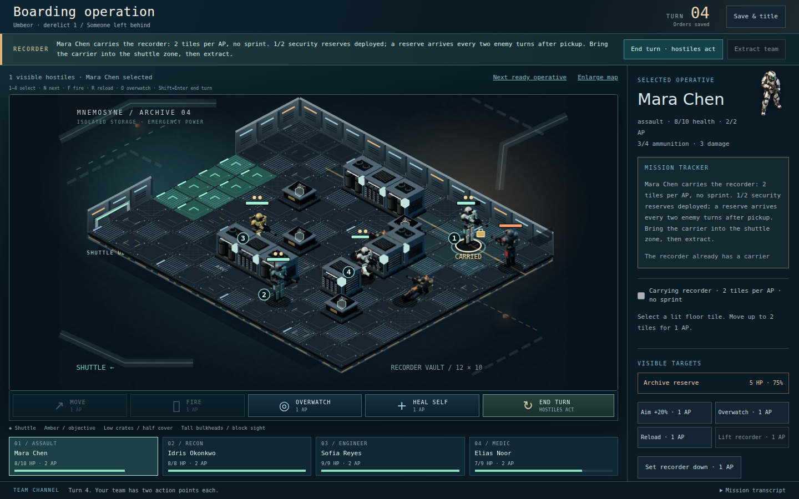

# Laptop boarding: archive vault and combat playback

Implemented 12 October 2026. Laptop/desktop is the product target, confirmed by
Paul. Phone-specific expansion and device profiling are out of scope; existing
narrow-screen layouts and regression checks are retained as a fallback.

## What changed

The recorder vault now uses cartridge racks, twin cooling cylinders, service
consoles, route markings and an amber recorder case. A vented cutaway hull frames
the deck. Machinery occupies existing wall/half-cover tiles; outer hull dressing
is outside the movement grid. Fog, sight lines and collision rules are unchanged.

The seven directional rigs have smaller helmets, longer legs, segmented chest
plates, hoses and straps. Two-bone arm constraints keep both hands at actual
rifle grip points during locomotion and firing. Hip sway, torso counterrotation,
reduced bob, self-shadowing and less reflective floors improve the presentation.
They remain pre-rendered WebP sheets: no runtime Three.js or WebGL dependency.

Enemy turns show the reducer's actual moves, overwatch interruptions, shots,
reloads, reserves and heat in order. The actor is highlighted and a caption names
the action and hit/miss result. Damage/shield changes appear with their action.
**1× / 2×**, **Skip playback** and **Esc** give control over pacing. Hidden movement
and reloads are not announced. A reserve warning does not reveal its position.

The game dispatches and saves the end-turn order immediately. Playback is
transient UI state and never enters the save. Reloading, returning to the title
or skipping presents the already-resolved outcome; it does not repeat RNG or
orders. Inputs are guarded during playback; a fatal turn plays before its debrief.
Reduced motion bypasses the sequence, retaining the written combat summary.

At 1366×768, the deck, primary quick actions and four squad cards fit together.
Detailed orders scroll independently. Enlarge map hides the sidebar and squad
strip, giving the scene additional height and width; Fit map restores them.
The full transcript opens above its compact footer. Keyboard shortcuts:

| Key | Action |
| --- | --- |
| 1–4 | Select operative |
| N | Next ready operative |
| F | Fire at selected target |
| R | Reload |
| O | Overwatch |
| Shift+Enter | End turn |
| Esc | Skip current playback |

Typing and the extraction confirmation suppress tactical shortcuts.

## Validation

- 297 unit/integration/golden tests in 33 files passed.
- All 50 browser scenarios passed, including existing campaign and save flows.
- After final skip/enlargement refinements, the seven relevant laptop/playback/
  animation browser scenarios were checked again.
- Production build passed; the pre-existing large-JavaScript-chunk advisory remains.
- Laptop captures reviewed at 1366×768, 1440×900 and 1920×1080. The first layout
  made the deck too small; reduced chrome reclaimed approximately 120px of height
  at 1366×768 before the final review.

`tests/tactical-playback.test.ts` verifies identical observed/unobserved results,
detached snapshots, overwatch ordering, one frame per shot, concealed movement
and fatal heat. `e2e/tactical-playback.spec.ts` checks laptop layout, genuine map
scale enlargement, keyboard selection, input lock, speed, skip, reload during
playback, one saved order per turn and reduced motion. Existing motion tests
sample multiple poses and test pointer selection.

Reproduce: `npm test`, `npm run build`, `npx playwright test`. To regenerate art,
run `npm run art:render` with Playwright Chromium installed (or set
`PLAYWRIGHT_CHROMIUM_EXECUTABLE_PATH` to a local compatible executable).

## Actual game captures

These are real saved mission states reached through legal campaign orders, not
concept images or artificial unit placement. The recorder carrier and reserve
are visible during the ongoing mission.

[1366×768 laptop](qa/laptop-archive-1366.png) ·
[Enemy shot during playback](qa/laptop-enemy-playback.png) ·
[Enlarged deck](qa/laptop-focus-1366.png)

## Remaining limitations

The graphics are still stylised and do not meet the photorealistic reference.
Higher-quality sculpted meshes, painted environment variation and civilian
locomotion remain future work. Civilians still use their earlier single bitmap.
Player orders resolve immediately and can interrupt their own visual movement;
only hostile turns have the ordered presentation queue. The art sheets keep the
same dimensions and approximate decoded-memory footprint as the previous pass.
Real laptop GPU profiling and independent human playtesting are not claimed.
Issue #18 should remain open.
